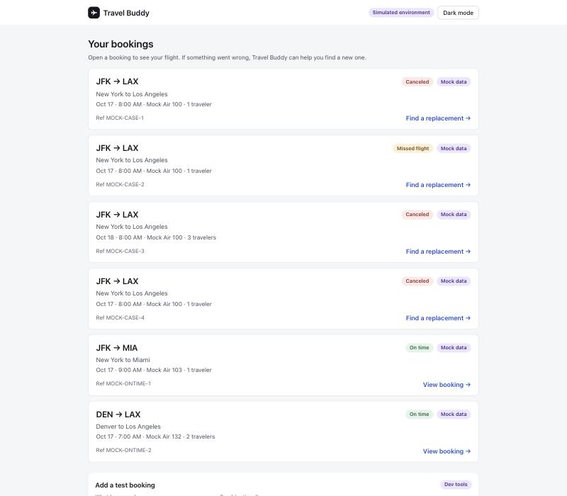
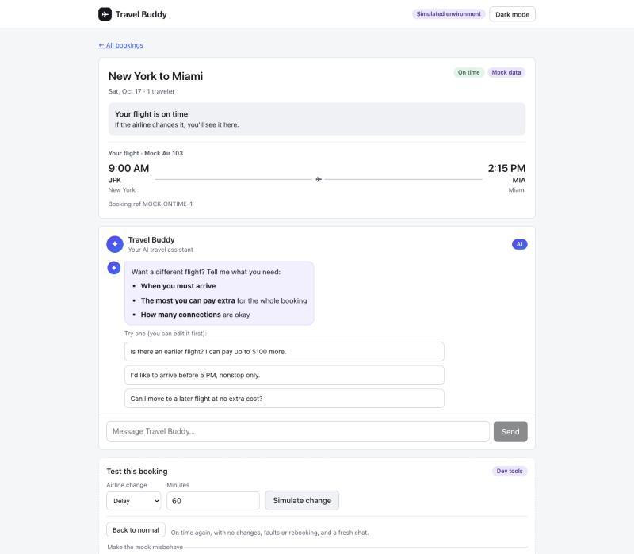

# Travel Buddy

An AI agent that helps a disrupted traveler compare replacement flights and complete a **simulated** rebooking. Claude reasons and explains. Application code enforces the rules, and the model has no tool that can book.

**Who it is for:** Travel Buddy is a traveler-facing recovery assistant for the airline and travel industry. It helps someone whose flight was canceled, delayed or missed choose a replacement, instead of waiting on hold or in line.

- **Traveler flow:** explains the disruption, asks for limits (extra cost, arrival time, connections), shows the options that fit as cards and recommends one, and rebooks only when the traveler presses Confirm.
- **Code decides:** eligibility, cost, currency, the traveler's limits, confirmation and duplicate-attempt checks are application code. Mock data and Duffel test data stay separate and labeled, and tool output is treated as untrusted.
- **Stack:** Python (FastAPI), React + TypeScript, Anthropic API, Duffel test API. 630+ backend tests.
- **Status:** MVP 1 works end to end on test data: bookings, airline-change detection, chat with option cards, the limits filter, safety guards, a strict confirmation gate, clear errors when the server or the AI is down, and an eval runner. Latest live run (`claude-haiku-5-5`): PRD cases 12 of 12 with 0 rule violations; requirement understanding 29 of 30 runs (97%, target 90%). Not a production airline integration.

## Screenshots
| Bookings list | Booking page |
|---|---|
|  |  |

All data shown is simulated test data.

## Run it
Put `ANTHROPIC_API_KEY`, `MODEL` and a Duffel **test** `DUFFEL_ACCESS_TOKEN` in a local `.env`, then:

```bash
python3.14 -m venv .venv && .venv/bin/pip install -r backend/requirements.txt   # first time only
.venv/bin/uvicorn backend.app.api.main:dev_app --port 8000 --no-access-log
cd frontend && npm install && VITE_DEV_PANEL=true npm run dev   # http://localhost:5173
```

## Check it
```bash
.venv/bin/python -m pytest backend/tests/unit                      # unit tests, no network
.venv/bin/python -m backend.tests.evals.runner --mode scripted     # the 4 PRD cases, free and repeatable
.venv/bin/python -m backend.tests.evals.runner --mode live --runs 3    # same cases with the real model (costs credit)
.venv/bin/python -m backend.tests.evals.runner --mode live --suite requirements --runs 3   # requirement understanding
```
The runner judges with code only, never with a second model.

## Out of scope for MVP 1
- **No real tickets.** Duffel's test mode and clearly labeled mock data only. Nothing is bought or changed with a real airline.
- **No splitting a group.** Everyone on a booking stays on the same itinerary.
- **No staff tool.** The support handoff is simulated, and no real staff follow up.
- **No payments, refunds or reimbursement promises.** The agent never promises any.
- **Prompt-injection defense is best effort.** Code enforces the limits and the confirmation, and text in tool results is treated as data, so a planted instruction cannot book anything. We have only checked it with `claude-haiku-5-5`, on the four PRD cases and fifteen requirement cases. An earlier run once prepared a rebooking when the traveler said to skip the rules; nothing was booked, and since then the gate refuses to prepare anything before a checked search and the prompt keeps the steps. It is still not proven for every model or input.
- **Not deployed.** Sessions live in memory, so run one backend process. A public demo would need protection first (see TASKS.md).

By [Jian Ting Li](https://github.com/JianTing-Li) (API, tools, Duffel, frontend) and [Cheich Toure](https://github.com/Cheicht) (agent, harness, evals). See [TASKS.md](TASKS.md).
